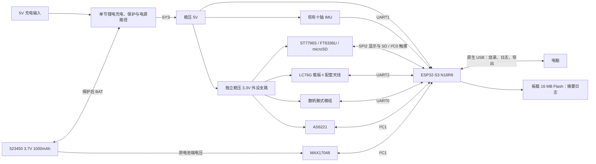

# SummitSense｜整机硬件方案 B（接线审查稿）

2026-11-10。适用主板：微雪 ESP32-S3-DEV-KIT-N16R8。保留十轴 IMU 和 AS6221；原 MAX30102、TK013F2261 和亚博 GNSS 退回原型备用。以下是新方案的接线分配。3.5 英寸显示和触摸均已实机通过，其余新接口仍待联调；[旧原型接线](hardware.md)仍用于现有固件。

## 1. 结论与硬件框图

主板的 GPIO、SPI、I²C 和 UART 足够，无需换板或加串口扩展器。前提是把电脑应用日志切到原生 USB Serial/JTAG，释放 UART0。三个硬件 UART 将全部占用。3.5 英寸屏幕适合手持/台架整机，模块外形约 61 × 92.44 mm；小型腕表应另选更小的屏幕和载板，而腕部传感头可先单独固定在手腕。

图中电脑 USB 表示通信路径，不表示电池 5V 可以与电脑 VBUS 并联。外设均共地。

## 2. 逐线接线：3.3V 逻辑，按丝印接

### 新屏 15PIN 接口

使用微雪 ESP32S3 示例同样的 3.3V 供电方式，但 GPIO 按本项目重新分配。仅向 **3V3** 输入稳压 3.3V，**VCC 留空**；不要同时给两个供电脚输入。下表按功能名列出，不是排针序号。

| 屏幕丝印 | 接到哪里 | 说明 |
|---|---|---|
| VCC | 留空 | 3.3V 模式 |
| 3V3 | 外设 3.3V | 屏幕、触摸、卡座载板供电 |
| GND | 系统 GND | 共地 |
| MISO | GPIO10 | SPI2 回读，启用板载 SD 时连接；仅写屏可先留空 |
| MOSI | GPIO11 | SPI2 主机发送 |
| SCLK | GPIO12 | SPI2 时钟 |
| SD_CS | GPIO21 | 板载卡片选，低有效；初测不插卡，启用时与 LCD_CS 分开 |
| LCD_CS | GPIO13 | LCD 片选，低有效 |
| LCD_DC | GPIO14 | 命令/数据 |
| LCD_RST | GPIO6 | LCD 复位控制 |
| LCD_BL | GPIO7 | 背光控制/PWM，GPIO 是控制线，不承担背光供电 |
| TP_SDA | GPIO8 | I²C0 SDA |
| TP_SCL | GPIO9 | I²C0 SCL |
| TP_INT | GPIO1 | 触摸中断输入 |
| TP_RST | GPIO2 | 触摸复位控制 |

旧 MAX30102 必须先拆下，包括原 GPIO10 的 INT。旧屏不与新屏并接。触摸先用 100 kHz，预期 7 位地址 0x38，以实物扫描为准。LCD 与 SD 共用 SPI2，只初始化一次总线，两个设备分别配置片选、时钟和事务；使未选中的设备片选保持高电平。先验证 LCD，再单测 SD，最后验证刷屏时持续写卡。若板载组合实测存在 MISO 争用，先排查卡初始化、片选、电平转换和线长，再决定是否用独立卡座和 SPI3；板载卡座与 LCD 的共享线不能靠软件改引脚拆成两条物理总线。

新屏是 320×480、ST7796S + FT6336U。旧 ST7789 的初始化表、240×240 布局和方向参数不能照搬。RGB565 单帧约 300 KiB，8 MB PSRAM 足以容纳界面资源；先用分块 DMA 缓冲、按需重绘，实测 SPI 时钟和刷新速度。

### 其他模块

下表 RX/TX 按**模块自身丝印**命名。所有 GND 接同一系统地。

| 模块 | 模块引脚 | 接到哪里 | 配置或注意点 |
|---|---|---|---|
| 数帆腕式心率血氧 | VCC、GND | 外设 3.3V、GND | 手册允许 3.3V 或 5V 供电，本案选 3.3V |
| 同上 | TX、RX | GPIO39（ESP RX）、GPIO40（ESP TX） | UART0，115200 / 8N1，3.3V TTL，两侧焊盘只用一侧 |
| LC76G 载板 | VCC、GND | 外设 3.3V、GND | 按载板规格供电；TX 空闲高电平先量测，不按导线颜色认脚 |
| 同上 | TX、RX | GPIO16（ESP RX）、GPIO15（ESP TX） | UART2，先按 LC76G(AB) 115200 / 8N1；先收 NMEA，需发配置才接 RX |
| 同上 | PPS、RST、SDA、SCL | 首轮留空 | 接配套天线，户外验证；不需要 PPS 才能定位 |
| 十轴 IMU | 5V、GND、TX | 稳压 5V、GND、GPIO18（ESP RX） | UART1，9600 / 8N1；使用已保存的气压配置 |
| 同上 | RX | 留空；GPIO17 预留 | 发送通路尚未证实；正常采集不接 IMU 自身 USB |
| EV9-AS6221 | VCC、GND | 外设 3.3V、GND | ADD0、ALERT/ADD1 延续接 GND，地址 0x48 |
| 同上 | SDA、SCL | GPIO4、GPIO5 | I²C1，100 kHz |
| MAX17048 模组 | BAT 或电池座 | 保护后的电池正端，负端共地 | 测实际电芯电压；不接 SYS、5V 或 3.3V 输出 |
| 同上 | VCC/VIN、GND | 外设 3.3V、GND | 按实物原理图确认 VCC 是供电还是逻辑参考，确认 SDA/SCL 上拉到 3.3V；不得把 BAT 与 VCC 短接 |
| 同上 | SDA、SCL、ALRT | GPIO4、GPIO5、暂留空 | 与 AS6221 共用 I²C1，7 位地址 0x36，先轮询电量 |
| 板载 BOOT | GPIO0 | 无新增线 | 保留；开机/复位不按住 |
| 板载 USB-C | 原生 USB D−/D+ | GPIO19/20 已在板内 | 电脑选原生 USB COM 口；不另接这两根 GPIO |

数帆模组自带测量流程。UART 上电先读 boot 行；贴合后自动输出心率，按需发 `AT+SPO2=1\r\n`，约 25 秒窗口内只采用有效结果；血氧与 HRV 互斥，摘下后需处理无效/过期和休眠。手册公开的是结果 JSON 与命令，不承诺开放原始 PPG；若实验必须保存红/红外原始波形，要另向厂商确认，现有 MAX30102 可留作实验对照。腕部输出不等于已完成准确性验证。

LC76G Wiki 混有旧模块的 9600 示例；按 LC76G(AB) 参数表从 115200 起步，无有效 NMEA 时再核对板型/已改配置及 9600。不要将旧 ATGM336H 的默认速率直接套过来。

### 接口余量与固件改动

- 3 路 UART 分给腕式模组、IMU、LC76G。现有 sdkconfig 主日志仍占 UART0，且 USB 只是次级输出。改为 `CONFIG_ESP_CONSOLE_USB_SERIAL_JTAG=y`，先验证原生 USB 烧录、双向控制/导出，再把 UART0 映射至 GPIO39/40。CH343 的 GPIO43/44 不接外设；保留恢复下载能力。GPIO39/40 不再留给外接四线 JTAG，原生 USB JTAG 不受该分配影响。
- I²C0 独立触摸，I²C1 共用温度和电量计；每条总线由一个组件创建，各设备只注册，不分别重建控制器。检查有效上拉与 3.3V 高电平。
- SPI2 用于 LCD+板载 SD，SPI3 不占用。按上述完整表（含 SD 和原生 USB）使用 22 个 GPIO，GPIO17 再预留一个。GPIO35/36/37 在 N16R8 不可用；避开其他启动绑带脚 GPIO3/45/46、板载 RGB 相关脚及板载串口。若一定要保留 CH343 为应用控制台，可评估 LC76G 厂商 I²C 示例作为替代，但本方案不依赖该接口。
- 接线与固件同时切换。现有 `board_config.h` 仍按旧屏、MAX30102 及旧控制台工作，本方案不修改代码或分区，也不代表已经联调。

## 3. 电池能否带动整机

1000 mAh 是容量，不能说明允许峰值电流。电芯标称能量约 3.7 Wh；MAX17048 只是电量计，不能代替充电、保护或稳压。当前没有找到这颗 523450 电芯的供应商额定充放电电流及保护参数，不能据型号确认整机带载。先核对电芯的充电终止电压、持续/峰值放电、保护阈值、插头极性和充电电流。

**推荐接法：** 5V 充电输入→适配该电芯的单节充电/电源路径模块；电芯接受保护 BAT，MAX17048 并接电池测量节点；SYS→稳压 5V 转换器→开发板 5V 和 IMU；同一系统 5V 经独立稳压到外设 3.3V。不要把外设 3.3V 并到开发板 3V3 输出。充电模块若选 BQ24074 类，其 SYS/OUT 不是稳压 5V。选型应匹配低电压时的输入电流、保护板能力、充电时负载共享和散热。

- 开发板 ESP32-S3 供电设计参考：乐鑫对芯片 3.3V 单电源建议至少 500 mA，这是供电能力要求，并非平均耗电。屏幕厂商称 3.3V 工作约 63 mA；LC76G(AB) 表列约 36 mA，不作为整块载板加有源天线的峰值。腕式模组与 SD 写入峰值未知。
- 台架可用有余量的稳压 5V 电源（如 2A 额定）先跑全系统；不要据此假定电芯可输出 2A。例：若整机实际瞬时取 5V×1A，按低电池 3.2V、转换 85% 估算，电池端约 1.84A，须核对电芯、保护板和转换器是否支撑。
- 仅作续航量级估算：若可用能量按 80% 取约 3 Wh，整机平均消耗 1 W、1.5 W、2 W 时分别约 3、2、1.5 小时。这里的功率要按电池侧测量；不是续航承诺。
- 电池不能直连 ESP32 的 3V3 或 5V。台架阶段用单一供电源；电池 5V 外供时不要同时接可供电的电脑 USB，除非已核实开发板 VBUS 隔离和电源切换方式。首次整机电池测试以低电量、背光全亮、GNSS 搜星、无线发送（如启用）和 SD 写入组合观察电压跌落、复位和温升。

## 4. 存储建议

当前是默认单应用分区，没有数据日志分区。16 MB Flash 是板载非易失容量，其中要留固件、NVS、将来的 OTA 等；8 MB PSRAM 是断电丢失的缓存。建议内部 Flash 留约 8 MiB 作短期摘要/掉卡缓冲（具体分区待核算），配合磨损均衡文件系统，例如 FATFS+wear levelling；NVS 存配置，不存连续日志。使用批量写入、分段轮换、断电恢复和 USB 导出，并测 Flash 写入与采集/刷屏并行时的丢包。

| 保存数据 | 举例写入量 | 8 MiB 理论时长 |
|---|---:|---:|
| 每秒一帧定长摘要：时间、心率/血氧有效位、温度、姿态、气压、定位摘要 | 64 B/s | 约 36 小时 |
| JSON/连续中等频率日志 | 1 kB/s | 约 2.3 小时 |
| 较高频原始数据或详尽文本 | 5 kB/s | 约 28 分钟 |

实际时长更短，取决于文件系统开销、保留余量及数据格式。多小时原始实验日志首选新屏**已有的 microSD 卡槽**，只需配卡并接上 MISO、SD_CS，无需再买转接模块；内部 Flash 可先验证摘要记录，不依赖 SD 才能开工。

## 5. 建议接入顺序

1. 在原接线下先切换并确认原生 USB 调试；记录原配置用于回退。
2. 断电移除旧屏/MAX30102。用台架供电按新表先接 LCD、再接触摸；确认方向、背光和地址。
3. 接数帆腕式模组，验证 AT 往返、贴合心率、血氧有效位；接 LC76G，用原配天线在户外验证有效定位；回归现有 IMU 和温度。
4. 先导出 Flash 摘要，再测试 SD 与显示并发；实测电流后才固定电芯、充电和稳压选型，最后验证佩戴与整机稳定性。

资料：[微雪主板](https://docs.waveshare.net/ESP32-S3-DEV-KIT-N8R8/)、[微雪屏幕](https://www.waveshare.net/wiki/3.5inch_Capacitive_Touch_LCD)、[LC76G Wiki](https://www.waveshare.net/wiki/LC76G_GPS_Module)、[LC76G 载板原理图](https://files.waveshare.com/wiki/LC76G/manual/LC76G%20GNSS%20Module.pdf)、[乐鑫 USB 控制台](https://docs.espressif.com/projects/esp-idf/en/v5.5.1/esp32s3/api-guides/usb-serial-jtag-console.html)、[供电设计](https://docs.espressif.com/projects/esp-hardware-design-guidelines/en/latest/esp32s3/schematic-checklist.html)、[MAX17048](https://www.analog.com/en/products/max17048.html)。腕式模组依据本地《使用手册(重要)》第 1–8 页；电量计依据本地《MAX17048 电量计.txt》，实际模组电路仍待核对。

## 6. 3.5 英寸屏幕单模块验证

首轮接 3V3、GND、MOSI、SCLK、LCD_CS、LCD_DC、LCD_RST、LCD_BL 共八线，VCC 留空。显示初测时不接触摸；当前测试固件会探测触摸，仍不驱动 microSD、旧屏或传感器。原生 USB 作为日志和烧录接口。

在 ESP-IDF 的 **SummitSense hardware** 菜单启用 `CONFIG_SUMMIT_LCD35_BRINGUP`。当前本机 sdkconfig 已启用该模式，旧原型仍可通过关闭该选项恢复。SPI 使用 10 MHz、模式 0、RGB565，初始化参数参考[微雪独立屏示例](https://www.waveshare.net/wiki/3.5inch_Capacitive_Touch_LCD)。上电后应依次出现全屏红、绿、蓝，随后停在有 `TOP`、四角标记、白边和色条的测试图。`# LCD35: pattern sent` 只确认 ESP32 发送完成，颜色、方向和完整画面需目视确认。

实机结果（2026-11-10）：COM5 烧录与串口心跳通过。首次显示左右镜像，将 ST7796S MADCTL 设为 0x48（MX=1，保留 BGR）后，用户确认显示正常。下一步单独接入 FT6336U 触摸，microSD 仍暂缓。

触摸测试（2026-11-10）：补接 TP_SDA=GPIO8、TP_SCL=GPIO9、TP_INT=GPIO1、TP_RST=GPIO2 后，COM5 烧录通过，I²C0 上 0x38 已应答。依次点亮左上、右上、右下、左下黄色圆环；每次单指点按后抬起。程序按这四点推断交换坐标轴与镜像，之后以十字标记触点。方向映射只在本次运行内有效，重启后需重新点四角。用户实机确认四角对齐流程及中心触点显示无异常。下一步将坐标方向映射移入正式界面，取消每次开机的四角测试流程。

## 7. 320×480 界面与触摸导航

Rev B 模式已由诊断页切换为七页 LVGL 演示界面。首次运行按左上、右上、右下、左下黄色圆环逐点设置，方向保存至 NVS 的 watch35/tp_dir_v1。保存成功后重启直接加载，正常烧录不擦除该项；全片擦除后需要重新设置。屏幕两侧滑动或点底部箭头可以前后翻页；BOOT 短按备用翻页，长按切换自动轮播（默认关闭）。

当前运行显示、触摸、系统心跳和 LC76G 只接收通道；其他传感器与 microSD 尚未接入。旧硬件配置仍可通过关闭 Rev B 选项使用。两个分辨率均完成同源 14 种状态渲染和 210 次切页检查，无标签裁切或分配残留。Rev B 新固件已通过 COM5 烧录，用户已确认实屏翻页和重启加载正常；随后地图版启动日志再次确认触摸方向从 NVS 成功加载。

定位页与 GPX 路线导入方法见 [navigation.md](navigation.md)。
