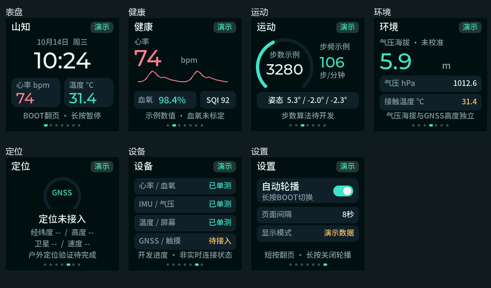

# 山知 SummitSense 手表界面（2026-10-14）

本阶段先完成 240×240 LCD 上的七页界面和导航。所有测量数值、表盘时间、日期及曲线均为演示样例，每页右上角持续显示“演示”；不读取传感器测量结果。原有传感器采集与串口输出继续运行，PC上位机仍显示真实串口数据。联合测试另行开展。



## 页面

| 页面 | 已实现的内容 | 当前边界 |
|---|---|---|
| 表盘 | 示例时钟、日期、心率、接触温度、导航提示 | 示例时钟随运行时间推进，没有联网校时或RTC |
| 健康 | 心率、示例PPG曲线、血氧、SQI | 血氧明确标记未标定，曲线不是实时波形 |
| 运动 | 进度环、示例步数/步频、姿态 | 步数/步频算法尚未开发，姿态样例顺序为roll/pitch/yaw |
| 环境 | 气压、气压海拔、接触温度 | 气压海拔未校准，温度不能当作核心体温 |
| 定位 | GNSS占位与缺失值 | 固件尚未接入GNSS，不显示虚构定位、卫星或轨迹 |
| 设备 | 各模块开发进度 | 已单测是历史验证状态，不代表当前实时在线 |
| 设置 | 自动轮播状态、8秒间隔、演示模式 | 轮播可通过按键切换；其他信息为说明，无虚假的亮度/记录控制 |

页面函数同时支持无数据的 `--` 状态，健康页附无效提示；当前烧录版默认只展示演示样例。

## 操作与烧录验收

1. 在VS Code中构建并通过UART烧录完整工程；无需修改当前屏幕接线。
2. 启动后首先显示表盘，每8秒自动切换下一页，底部圆点标识位置。
3. 运行时短按开发板BOOT进入下一页，长按至少1秒开启/关闭自动轮播。按键有40ms去抖，长按不会附带一次翻页。
4. 不要在上电或复位时按住BOOT，GPIO0也用于进入下载模式。
5. 检查中文、数字、RGB颜色、左右方向、完整边缘及各页面切换。模拟预览不能替代实屏目视验收。
6. 触摸SDA/SCL尚未接入，当前无需增加接线；CST816D驱动与滑动导航后续开发。

轮播状态只保存在RAM，复位后恢复自动轮播。当前按键仅控制界面，不改变传感器采集配置。

## 实现方式

- `components/display_panel`：独立ST7789S SPI传输；保留TK013F2261 V1.3实屏验证通过的厂家寄存器、MX=1镜像修正与BGR设置。10MHz SPI、软件复位，无可控背光GPIO。
- `components/watch_ui/watch_pages.c`：与平台无关的LVGL页面、样例与缺失状态布局；中文子集字库16/20px，关键数字32/48px。
- `components/watch_ui/watch_ui.c`：ESP-IDF任务、时钟节拍、BOOT处理与屏幕刷新。单任务独占LVGL，无跨任务直接操作控件。
- LVGL固定为9.2.2，依赖清单与`dependencies.lock`锁定版本。LVGL自身池96KiB；两块240×40 RGB565内部DMA缓冲共38,400字节。SPI刷新仅提交变化区域，不每轮重复设置相同的时钟文字。
- 刷新前交换RGB565字节顺序；完成回调到达后才交还缓冲。超时/传输失败停止UI任务并保留缓冲，其他采集任务继续。
- `display_test`保留独立RGB/边框诊断，复用同一个屏幕驱动。诊断模式和UI不能同时启动；默认入口已切换到UI。

## 同源预览与检查

`tools/watch_ui_preview`使用实际页面C代码、实际字库及LVGL生成240×240 PPM，不是单独绘制的概念稿。默认生成7页演示与7页无数据预览，检查文字宽度和画面边界，并执行210次页面切换、内存完整性与分配残留检查。

PowerShell命令（原生GCC与CMake/Ninja已安装）：

```powershell
cmake -S tools/watch_ui_preview -B tools/watch_ui_preview/build -G Ninja
cmake --build tools/watch_ui_preview/build
New-Item -ItemType Directory -Force tools/watch_ui_preview/build/screens
tools/watch_ui_preview/build/watch_ui_preview.exe tools/watch_ui_preview/build/screens
```

当前PC检查：14种页面状态无文字裁切；210次切换无保留分配，LVGL峰值16,224字节。ESP32任务栈、内部空闲量及持续刷新仍需实机观察，PC结果不是MCU资源验收。

## 字体与设计来源

采用深色底、大数字、有限信息密度和一致导航；参考[Apple watchOS界面设计原则](https://developer.apple.com/design/human-interface-guidelines/designing-for-watchos)，未使用其图标、截图或商标资产。

中文为Google Fonts Noto Sans SC Medium的子集，源字体使用SIL OFL 1.1，许可保留在`tools/ui_assets/fonts/OFL.txt`。生成工具`lv_font_conv`为1.5.3，字体构建说明见`tools/ui_assets/README.md`。字体更新不影响采集算法。

## 下一阶段

先完成实屏界面验收，然后接入触摸导航、统一数据快照与有效状态；再将心率/血氧、温度、姿态和气压替换为真实值。GNSS、步数、校时、续航/电量和存储功能按各自硬件与验证条件逐步接入。

固件构建验证：ESP-IDF v5.5.5、ESP32-S3目标通过；应用镜像703,280字节（约687KiB），1MiB应用分区剩余33%。已有15项温度/IMU/生理测试全部通过。尚未烧录本轮七页UI进行实屏验收。
