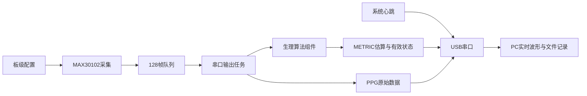
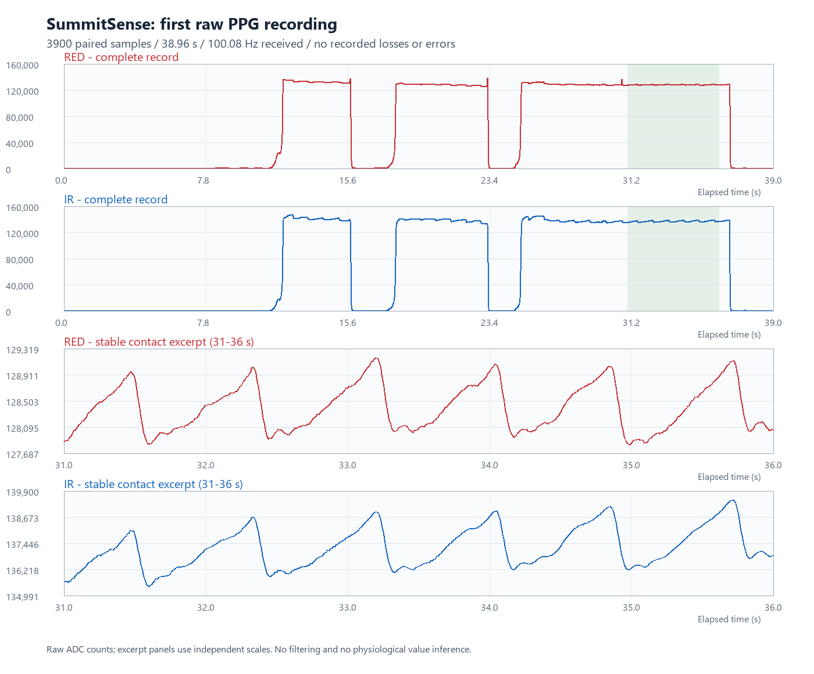

# 山知 SummitSense：阶段工作进展报告

**报告日期：2026年10月13日**
**工程名称：summit_sense_watch**
**当前阶段：生理信号采集与算法演示原型**

## 1. 阶段结论

目前已完成“开发板运行 → MAX30102双通道光学采样 → USB串口传输 → PC记录与实时波形 → 心率与血氧实验估算”的完整链路，并建立模块化代码结构与Git版本管理。

已获得手指接触条件下的红光、红外脉搏波。采样记录约为100 Hz，已验证记录中未观察到FIFO溢出、串口可见序号缺口、输出队列丢样或I²C通信错误。实时心率与实验血氧输出已由开发者进行实机演示确认。

现阶段交付的是可回放、可分析的原型采集平台。尚无专业参考设备，心率准确性和血氧标定未完成；估算值用于展示与研究，不用于低血氧报警或高原风险判断。IMU、GNSS、温度和屏幕模块已选型，但还未接入当前固件。

## 2. 项目目标与当前范围

长期目标是面向户外与高原场景，结合生理、运动、位置与环境数据，形成可穿戴感知和状态分析平台。

当前开发优先级为：

1. 稳定采集原始信号，并保留数据质量信息。
2. 在PC保存数据、查看波形并回放算法。
3. 显示具有有效状态的心率与血氧实验估算。
4. 逐步增加多传感器同步采集。
5. 在数据可靠性与佩戴结构验证后，再推进算法评估、功耗、PCB和整机。

本阶段暂缓超声波和microSD。采用USB串口向PC保存数据；因此目前需要电脑连接才能完成完整实验记录。

## 3. 硬件选型与接入状态

| 子系统 | 已选硬件 | 选择理由与用途 | 当前状态 |
|---|---|---|---|
| 主控 | 微雪ESP32-S3-DEV-KIT-N16R8 | 双核处理、多外设、16 MB Flash和8 MB PSRAM，支持USB、后续显示与算法 | 已接入、运行验证通过 |
| 生理检测 | 野火小智MAX30102模块 | 集成红光、红外LED、光电检测及ADC，可读取原始PPG | 双通道采集及实验算法已实现 |
| 运动与气压 | 亚博十轴IMU惯导模块 | 加速度、角速度、磁场、姿态与气压等输出，用于活动、步数、步频及高度趋势 | 已购、有资料，待接入 |
| 定位 | 亚博GNSS模块，ATGM336H-5N载板 | 经纬度、地速、UTC、定位质量及GNSS海拔 | 已购、有资料，待接入 |
| 温度 | AS6221温度传感器 | 温度变化与接触温度趋势 | 已选，待接入与核对板级资料 |
| 显示 | 1.3寸240×240方形彩色SPI屏 | 显示估算值、信号有效状态及传感器状态 | 已选，驱动芯片待确认 |
| 备用主控 | 微雪ESP32-C6-Zero | 保留作单模块测试或备用 | 当前不用作主控 |
| 存储 | PC端记录 | 保存原始日志、CSV、波形及质量统计 | 已实现 |
| 移动供电与交互 | 电池、电源管理、按键等 | 后续佩戴、移动测试与续航验证 | 待设计，不是本轮已完成项 |

开发板便于验证，但当前尺寸、USB芯片和指示灯等不能直接代表最终腕表尺寸与功耗。选型将在佩戴与电源测试后继续评估。

## 4. 已实现功能与实现方式

### 4.1 开发环境和基础运行

- Windows + VS Code + ESP-IDF扩展2.3.0，固定ESP-IDF v5.5.5。
- 芯片目标为esp32s3；Flash配置16 MB、DIO、80 MHz。
- PSRAM配置为Octal、80 MHz，启动初始化与内存测试，允许malloc使用。
- 完成官方示例烧录，再替换为持续运行的心跳程序。
- 使用板载CH343进行UART烧录与日志传输，当前串口115200 baud。
- 每秒输出运行时间、序号、内部空闲内存、历史最低空闲内存与PSRAM空闲量。
- 使用sdkconfig.defaults保存已验证板级配置，便于换环境重建。

### 4.2 MAX30102通信与原始采集

接线：3V3→3V3、GND→GND、SDA→IO8、SCL→IO9、INT→IO10。模块已有上拉；INT当前未用于中断采集。

初始化通过I²C地址0x57探测与器件寄存器读取；实测PART_ID=0x15、REV_ID=0x03。

当前采样配置：

| 参数 | 配置 |
|---|---|
| 通道 | 红光RED + 红外IR，每条记录一对样本 |
| 有效输出目标 | 100对样本/秒 |
| ADC | 18位，原始范围0～262143 |
| LED脉冲宽度 | 411 μs |
| ADC量程 | 4096 nA |
| LED电流 | 每通道标称7.2 mA |
| 芯片平均 | 1，不做平均降采样 |
| I²C速度 | 100 kHz |
| 读取方式 | 每约10 ms轮询，批量读取FIFO |
| FIFO策略 | 禁止满后滚动覆盖，统计可观察到的丢样下限 |

采集任务与串口输出任务分离，由128帧队列连接。队列满时统计丢样；通信错误后尝试恢复传感器配置，并标记新的采集epoch。原始记录保留序号、估算时间戳、两路值、质量标志、FIFO丢样下限、队列丢样数及错误次数。

### 4.3 心率与血氧效果显示

- 以800样本形成8秒滑动窗口，每约1秒更新。
- 去除线性基线，进行5点平滑，在窗口中间6秒分析。
- 使用IR自相关估计周期，再以脉搏谷值间隔中位数交叉验证；当前范围40～180 bpm。
- 对无接触、弱信号、饱和、缺口、基线变化、两路不一致与周期不稳定进行筛选。
- 输出心率估算、血氧实验估算、信号质量分数SQI、比值R、有效标志与原因。
- 无效状态显示“--”，新指标超过3秒未到达时也失效；不保持旧值冒充当前测量。
- 血氧始终带calibrated=0，界面标注未标定。数值越界时不强行修正为正常范围。

### 4.4 PC数据工具

串口工具可同时实时显示与保存，避免多程序占用同一COM口。输出包括：

| 文件 | 内容 |
|---|---|
| raw.txt | 完整串口日志，包括配置和错误信息 |
| ppg.csv | 红光、红外原始样本与质量字段 |
| system.csv | 系统心跳与内存状态 |
| metrics.csv | 心率、未标定血氧估算、有效状态与算法质量 |
| summary.json | 记录数量、格式错误和序号缺口等 |
| quality.json | 按重启会话统计采样率、时间间隔、饱和及错误计数增量 |
| ppg.svg | 最后10秒双通道原始波形 |

实时窗口显示最近6秒波形、算法状态与估算值。波形两路独立自动缩放，缺口处不连线；自动缩放也可能放大噪声，仍需结合质量统计判断。

## 5. 测量原理

### 5.1 PPG与心率

MAX30102使用红光、红外照射组织，光电检测器读取反射光。血液容积随脉搏变化，使检测值出现周期性变化，这就是光电容积脉搏波PPG。

信号可分为基线DC与随脉搏变化的AC。通过识别重复脉搏事件的间隔，可估计脉搏频率：

```text
脉搏频率(bpm) = 60 / 脉搏间隔(秒)
```

当前代码显示为心率估算，但其直接输入是PPG脉搏波，不是心电图。姿态变化、接触压力、环境光和运动也可能改变波形；周期性运动可能误导算法，当前不能保证运动场景准确。

### 5.2 血氧实验估算

含氧与脱氧血红蛋白对红光、红外的吸收不同。分别计算两路AC/DC，再计算比值：

```text
R = (ACred / DCred) / (ACir / DCir)
```

当前采用AC的RMS幅值和参考二次式：

```text
SpO2_est = -45.060 × R² + 30.354 × R + 94.845
```

上述系数是实验参考，并未针对本模块光路、遮光结构、指腹压力和本项目AC计算方式标定。RMS方式与参考实现的逐搏峰谷方式也不同，不能假定系数对应的精度可以直接迁移。

后续需获取同步参考数据，评估R与参考值关系，再决定算法形式与系数。正常静止场景对照只能评估所覆盖范围的一致性，不能证明低血氧区间准确。当前先用于功能展示，不做低血氧报警或高原风险决策。

### 5.3 后续运动、海拔、定位与温度

| 数据 | 基本原理 | 后续验证重点 |
|---|---|---|
| 运动、步数与步频 | IMU检测加速度和旋转，分析重复运动及步事件间隔 | 腕部摆动误计数、持物或登山杖漏计数、与PPG同步 |
| 气压高度趋势 | 利用气压随高度变化的关系估计相对高度 | 天气及气压漂移、起点校准、与GNSS高度分别记录 |
| GNSS位置与速度 | 接收卫星导航信号解算位置、时间和速度 | 室外定位、天线位置、卫星数、HDOP和失效状态 |
| 温度趋势 | 数字温度传感器测量自身接触位置温度 | 贴肤结构、响应延迟与主板热源；不能直接当核心体温 |

这些模块尚未在当前固件中实现，原理说明是后续技术路径。

## 6. 软件架构



目录按ESP-IDF组件组织：

```text
main/                       应用启动与调用顺序
components/board_config/    板级GPIO与基础参数
components/system_monitor/  系统运行与内存监视
components/max30102/        器件通信、FIFO采集和输出
components/physiology/      心率与实验血氧处理
tools/serial_logger/        PC记录、波形和质量统计
tools/physiology_replay/    同一C算法的主机回放
tests/                      算法软件测试
docs/                       架构、接线、协议、验证和工作汇报
```

使用显式组件依赖保持职责清晰。后续增加IMU、GNSS、温度、数据管理和UI组件；共享I²C总线生命周期及多传感器同步仍需设计。原始数据忽略Git并单独备份，代码、配置、文档与测试纳入版本管理。

## 7. 已有测试证据

### 7.1 基础硬件与采集记录

串口确认Flash为16777216字节、PSRAM可分配容量为8388608字节。早期心跳观察内存稳定，开发者反馈持续运行未发现问题；目前不宣称完成8小时或低温整机压力测试。

| 记录目录 | PPG样本对数 | 设备时间跨度 | 接收速率 | 关键结果 |
|---|---:|---:|---:|---|
| 20261013_120718_940399 | 3900 | 约38.96秒 | 约100.08 Hz | 无已记录丢样/错误，稳定接触段有清晰重复波形 |
| 20261013_121028_650658 | 6002 | 约59.99秒 | 约100.03 Hz | 无丢样/错误/饱和；含接触切换与不稳定阶段 |
| 20261013_204713_180850 | 5995 | 约59.91秒 | 约100.05 Hz | 有实时指标记录，无丢样/通信错误；2次估算时间戳修正 |

最新记录PC采集时长约60.09秒，保存60条METRIC。其中41条通过原型心率质量门限，占该次指标更新的约68.3%。其余为等待窗口、无接触或质量未通过；此比例受实验阶段和接触条件影响，不能直接作为测量准确率或稳定静止条件下的性能指标。

最新记录通过门限的脉搏频率输出范围约86.96～96.77 bpm，中位数约91.6 bpm。这是算法演示输出，没有同步参考值，因此不据此判断误差或生理状态。



图：20261013_120718_940399记录。上方是完整接触变化，下方放大31～36秒的原始红光与红外波形；两路使用独立坐标尺度，没有滤波。此图不是最新记录的指标图。

### 7.2 软件验证

- 固件在ESP-IDF v5.5.5下编译通过。
- 5组主机测试通过：已知60/72/90/120/150 bpm信号；无接触、平直和饱和；缺口后重新等待窗口；血氧公式越界不钳位；随机噪声拒绝。
- 主机测试和离线回放调用同一份C生理算法，避免PC与固件使用不同实现。
- PC数据解析、重启会话、序号缺口、CSV/SVG输出及METRIC记录已验证。
- 开发者反馈实机可显示心率与血氧估算，最新metrics.csv提供实际输出证据。

合成信号测试验证程序计算与失效处理，不证明人体测量准确性。当前缺少专业参考设备，未给出心率误差、血氧误差或医疗精度指标。

## 8. 局限与尚未解决的问题

| 局限 | 影响 | 处理方向 |
|---|---|---|
| 血氧未标定，心率无参考对照 | 能显示数值但准确性未知 | 保留未标定标签，后续同步对照和独立评估 |
| 静止指腹验证为主 | 不能证明腕部或运动场景可用 | 固定佩戴、遮光，再结合IMU观察运动伪影 |
| 时间戳按FIFO快照回推 | 有轮询和传输误差，不是芯片逐样本授时 | 保留估算标识与修正标志；不据此开展高精度HRV结论 |
| FIFO溢出计数会饱和 | 丢样计数只能是下限 | 联合序号、epoch、错误事件分析，不把下限当精确数 |
| 质量门限是原型启发式 | 可能拒绝有效数据，也可能放过周期性运动 | 收集标注数据，评估有效率和误接受情况 |
| 没有统一多设备总线/同步层 | 目前仅单生理模块加心跳 | 集成IMU时建立统一数据接口、缓存与时间模型 |
| PC连接记录 | 无独立户外长时间存储 | 后续评估BLE、外部Flash或microSD及容量需求 |
| 无电池、外壳和功耗测试 | 尚不能评估腕表尺寸、续航与低温表现 | 传感器稳定后再推进整机 |
| LCD驱动未确认 | UI尚未实现 | 获取型号与接口资料，逐步接入esp_lcd/LVGL |
| 尚无症状标签与模型评估 | 不能证明高原不适预测功能 | 先建立可靠数据集与标签方案，再研究离线模型 |

## 9. 下一阶段工作计划

以下是按验收安排的优先顺序，不是已完成结果或固定交付日期。

| 优先级 | 工作 | 交付物 | 验收要点 |
|---|---|---|---|
| P0 | 保存当前里程碑与数据备份 | Git提交、工作报告、实验数据目录 | 配置与算法可复现，数据可追溯 |
| P1 | 接入亚博十轴IMU | UART驱动、字段解析、IMU原始记录 | 默认9600/10 Hz跑通后提高至目标50～100 Hz，按实际模块配置核对；无明显丢包 |
| P1 | PPG与IMU同步采集 | 统一时间戳和格式、PC运动曲线 | 静止/摆臂/步行实验可回放，能关联运动与PPG失效 |
| P2 | 心率/血氧演示质量优化 | 算法有效状态、实验标签和质量报告 | 无手指不保持旧值；运动与静止有效比例可统计 |
| P2 | GNSS与AS6221 | 定位、时间、温度记录 | GNSS失定位有明确状态，温度与热源影响可观察 |
| P2 | 屏幕效果显示 | 估算值与状态页面 | 显示心率估算、未标定血氧、有效状态及传感器状态；刷新不影响采集 |
| P3 | 参考设备对照 | 同步参考记录、误差与一致性分析 | 区分正常范围初步对照和完整血氧标定；不凭单点调公式 |
| P3 | 可穿戴与电源 | 固定结构、供电方案、功耗记录 | 佩戴稳定、原始信号可用，再估算续航 |

屏幕第一版只做采集状态和基础数据页。生理数值以“估算/未标定”表达，不接入低血氧报警或高原风险评分。

## 10. 所需资料、设备与协作支持

### 现在需要

- 核对十轴IMU实物接口、模块版本、数据协议与输出配置；已有手册可作为起点。
- 确认LCD驱动芯片、接口标注、供电和背光控制方式。
- 获取AS6221具体模块接线、地址与供电资料。
- 准备短连接线及可靠固定方式，减少松动；为PPG设计简单遮光与稳定接触结构。
- 建立实验标签：静止、移开、摆臂、步行、接触压力变化；保存实际动作时间。
- 为data/raw做独立备份，记录固件提交号、采样参数、佩戴条件与实验说明。

### 后续需要

- 可同步记录的可靠参考心率/血氧设备，或实验室合作条件。
- 若要覆盖低血氧区间的标定，需要专业实验与安全管理条件，不自行通过降低氧供制造数据。
- 测量系统电流的工具、电池及电源管理资料，支撑真实续航预算。
- 机械固定、遮光、天线和贴肤温度结构设计支持。
- 若继续研究高原状态分析，需要明确研究方案、标签、参与者条件和模型评价方法。

目前没有专业参考设备，不阻塞采集平台、IMU、显示和整机原型开发；准确性及标定保留为独立验收事项。

## 11. 汇报演示建议

演示顺序：展示模块接线与目录架构 → 放置指腹显示双通道波形 → 等待稳定窗口显示心率/实验血氧 → 移开手指显示无效状态 → 展示CSV、质量统计和回放结果。

汇报时可以表述为：

> 本阶段完成了基于ESP32-S3和MAX30102的双通道生理信号采集、PC实时记录及心率和血氧实验估算。约100 Hz的采集链路已获得实际记录验证，并加入失效处理和可回放的软件架构。当前生理值用于原型效果展示，准确性与血氧标定尚待参考设备对照。下一阶段将接入IMU，验证运动条件下的同步采集和信号质量，再逐步集成定位、温度与屏幕。

## 12. 技术依据与附件

- [ESP-IDF组件与构建体系](https://docs.espressif.com/projects/esp-idf/en/v5.5.5/esp32s3/api-guides/build-system.html)
- [微雪开发板型号与硬件](https://docs.waveshare.net/ESP32-S3-DEV-KIT-N8R8?variant=ESP32-S3-DEV-KIT-N16R8)
- [MAX30102产品与数据手册](https://www.analog.com/en/products/MAX30102.html)
- [参考血氧公式实现](https://github.com/sparkfun/SparkFun_MAX3010x_Sensor_Library/blob/master/src/spo2_algorithm.cpp)
- [ADI血氧测量及标定说明](https://www.analog.com/en/resources/technical-articles/guidelines-for-spo2-measurement--maxim-integrated.html)
- [工程架构](architecture.md)、[接线](hardware.md)、[PPG协议](ppg_protocol.md)、[算法](physiology.md)、[验证](validation.md)

本报告依据当前源码、用户实机反馈、上述记录的CSV/JSON和软件测试整理。厂家PDF保留在上级项目数据手册目录；原始实验数据不纳入Git，报告中的记录目录名用于追溯，换电脑需另行复制数据。
